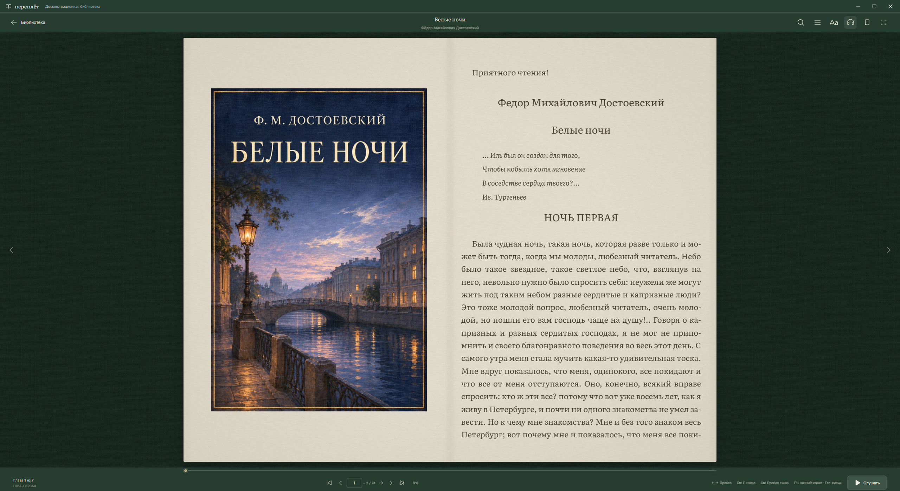
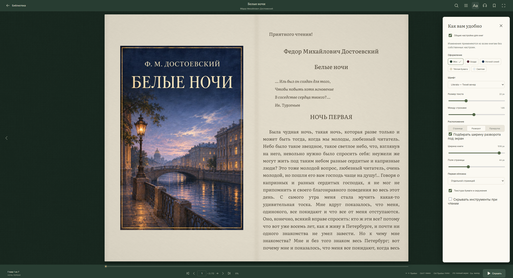
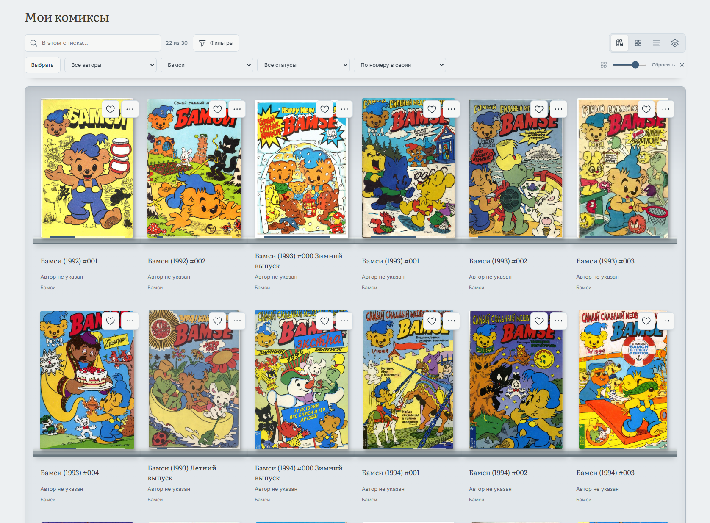
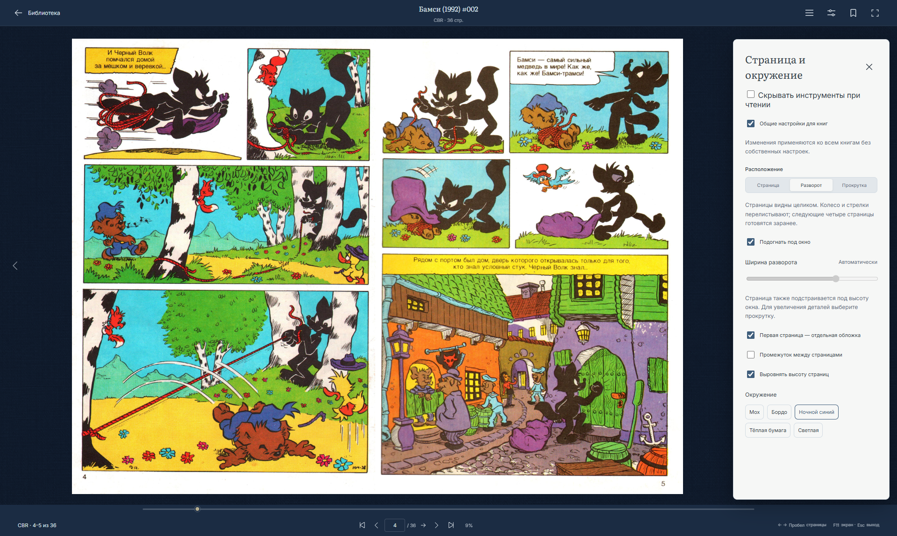
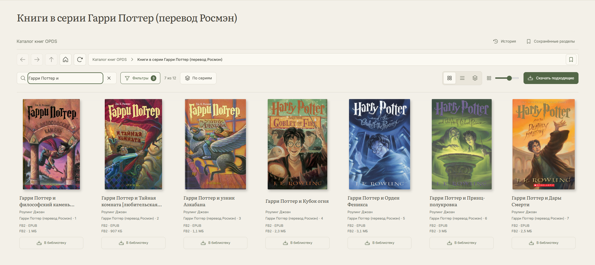
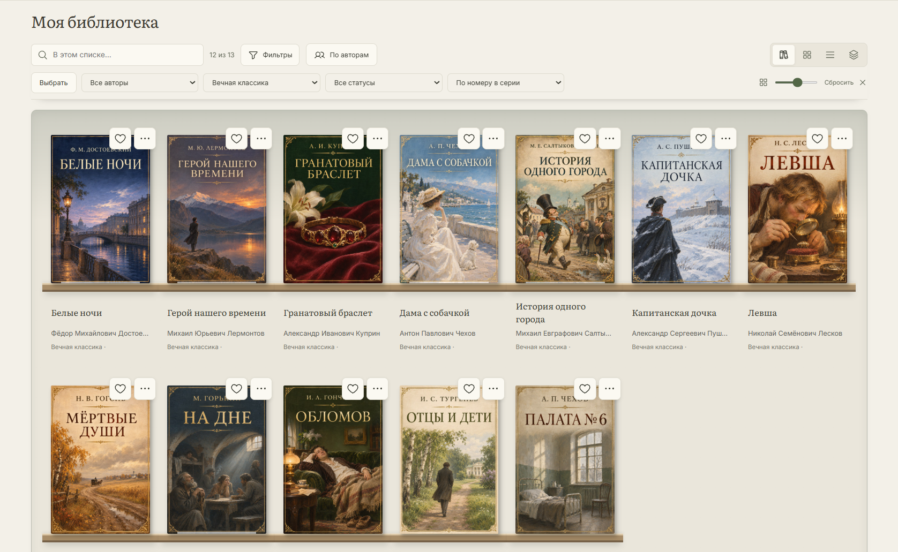

# Переплёт

[](https://github.com/Abzac/pereplet/actions/workflows/windows-release.yml)
[](https://github.com/Abzac/pereplet/releases/latest)
[](LICENSE)
[](https://github.com/Abzac/pereplet/actions/runs/45383120411)
[](https://github.com/Abzac/pereplet/actions/runs/45383120411)

[](#начать-читать)
[](https://tauri.app/)
[](https://svelte.dev/)
[](https://www.python.org/)
[](https://www.rust-lang.org/)

Число прошедших тестов указано для проверенной сборки 0.1.0. Бейдж CI показывает текущий статус проверок ветки main.

**Личная библиотека для Windows с поддержкой книг, комиксов и чтения вслух.**

Переплёт предназначен для организации коллекции и чтения электронных книг. В оформлении основной акцент сделан на содержимом книги, типографике и обложках. Приложение хранит файлы и настройки на вашем компьютере, сохраняет позицию чтения и поддерживает добавление книг из локальных файлов и OPDS-каталогов.



Все скриншоты сняты в рабочей версии приложения при чтении реальных книг и комиксов. Это снимки интерфейса, а не макеты или изображения, сгенерированные нейросетью.

## Возможности

- **Книги и документы:** FB2, FB2.zip, EPUB, TXT и PDF.
- **Комиксы:** CBZ, CBR и PDF; отдельная коллекция и собственные серии.
- **Три режима чтения:** одна страница, разворот и непрерывная прокрутка.
- **Оформление под себя:** пять цветовых тем, книжные шрифты, размер текста, интервалы, поля, ширина страницы и текстуры.
- **Локальная озвучка:** Piper, комплектный русский голос «Дмитрий», дополнительные голоса из интерфейса.
- **Порядок в коллекции:** авторы, серии, номера выпусков, поиск и фильтры; полки, обложки, список или таблица.
- **Планы и история чтения:** «Сейчас читаю», «Хочу прочитать», «Прочитано», закладки и сохранённые позиции.
- **OPDS внутри приложения:** поиск, переходы к авторам и сериям, предзагрузка списков, история запросов и сохранённые разделы.
- **Управление коллекцией:** действия над одной книгой или выделенной группой, назначение серий, перенос между книгами и комиксами, обратимый архив.
- **Масштаб библиотеки:** от 100 до 150%, по умолчанию 115%; страницы книги настраиваются независимо.
- **Готовность к первому чтению:** 12 классических произведений с обложками и иллюстрированное руководство FB2 в комплекте.

## Начать читать

В разделе [Releases](https://github.com/Abzac/pereplet/releases/latest) доступны два варианта с одинаковым составом книг и компонентов:

- **Установщик — Pereplet-Setup-Windows-x64.exe.** Запустите мастер установки, выберите папку и при необходимости создайте ярлык на рабочем столе. На последнем шаге можно сразу открыть приложение. Установка выполняется для текущего пользователя без прав администратора.
- **Portable — Pereplet-Tauri-Windows-x64.zip.** Распакуйте весь архив в папку, доступную для записи, и запустите **Pereplet.exe**.

Python, Node.js и отдельная установка WebView2 не требуются. Программа работает в собственном окне; локальный сервер запускается и завершается вместе с ней. Повторный запуск активирует уже открытое окно.

В новой библиотеке первой расположена серия **«Ваш Переплёт»** с книгой **«Переплёт. Руководство читателя»**. Это обычная FB2-книга с оглавлением и иллюстрациями: её можно читать, искать по тексту и слушать. Далее находится подборка **«Вечная классика»**. Книги доступны независимо от выбранной темы. После первого закрытия руководства оно скрывается с полки, сохраняя позицию чтения. Открыть его снова можно через «Помощь» в левом меню; кнопка «Скрыть с полки» позволяет убрать вводную подборку сразу.

## Настройки отображения и чтения



Для текстовых книг можно выбрать шрифт, размер и межстрочный интервал, настроить поля и ширину разворота. Автоматическая ширина учитывает окно и ограничивает длину строки на больших экранах. Позиция чтения сохраняется; счётчик страниц всей книги пересчитывается в фоне после изменения оформления.

Настройки могут быть общими или индивидуальными для книги. Полноэкранный режим и необязательное автоматическое скрытие инструментов оставляют больше места тексту. Поиск по книге или текущей главе показывает фрагменты найденных мест и позволяет вернуться к прежней позиции. Иллюстрации открываются отдельно с увеличением колесом мыши.

PDF сохраняет исходную вёрстку: шрифты и интервалы такого документа не заменяются настройками текстовых книг.

## Поддержка комиксов



**CBZ** содержит страницы в ZIP-архиве, **CBR** — в RAR-архиве. Оба формата читаются непосредственно в Переплёте; необходимый декодер RAR включён в Windows-сборку. **PDF** можно отнести как к книгам, так и к комиксам — тип коллекции меняется через меню издания или массовое действие.

Создавайте серии, выделяйте несколько выпусков и назначайте им общую серию. При наличии номера выпуска книги упорядочиваются внутри серии. Для одиночного издания доступно то же меню действий, что и для группы.

- Одна страница, двухстраничный разворот или непрерывная прокрутка.
- Подгонка под окно и настройка ширины.
- Отдельная первая обложка, промежуток между страницами и выравнивание высоты.
- Возможность убрать промежуток, чтобы соединить рисунок на развороте.
- Предзагрузка соседних страниц; текущая страница остаётся на экране до готовности следующей.
- Сохранение позиции и индивидуального оформления, полноэкранное чтение.



## Чтение вслух

В готовую Windows-сборку входит **Piper и голос «Дмитрий»**: чтение вслух доступно сразу и работает локально, без отправки текста книги в облако. Дополнительные голоса скачиваются один раз через заметный пункт «Скачать ещё голоса».

Нажмите «Начать читать вслух» или выберите абзац, с которого хотите начать. Доступны скорость, громкость, осторожное восстановление «ё», перелистывание вслед за голосом и размер аудиобуфера. Воспроизведение начинается после подготовки первого фрагмента; следующие готовятся постепенно. Главы продолжаются автоматически, если не включена остановка в конце главы. Перелистывание внутри длинного абзаца приблизительное: оно основано на времени аудио.

Озвучка предназначена для извлечённого текста книг. Распознавание текста на сканах PDF и страницах комиксов не выполняется.

## Каталоги OPDS



Ищите книги и авторов, открывайте серии, просматривайте обложки и описания, затем добавляйте выбранные издания в свою библиотеку. Списки подгружаются при прокрутке. Поиск по текущему списку, группировка по сериям и фильтры языка, состава авторов и других признаков помогают отобрать нужные издания по доступным метаданным.

Для каталогов с раздельным поиском книг и авторов обе выдачи показаны на одной странице; переключатель задаёт порядок разделов. Если сервер не распознаёт полное имя автора, приложение пробует отдельные слова и сопоставляет найденные имена.

История поисковых запросов появляется при фокусе в поле поиска. Разделы каталога можно сохранять для быстрого возвращения. Если каталог сообщает размер файла и номер книги в серии, Переплёт показывает их без предварительного скачивания книги.

Поддерживаются различные OPDS-каталоги и добавление пользовательских адресов. Доступность и возможности внешних каталогов зависят от их серверов. Наличие записи в каталоге не означает, что её формат поддерживается приложением.



## Библиотека и данные

Исходные файлы при импорте остаются на месте; рабочие копии, база, настройки и позиции находятся в **data/** рядом с программой. «Хочу прочитать» — личный список планов, который меняется сердечком. Статус завершения можно поставить вручную; переход к последней странице сам по себе не доказывает, что книга прочитана. Архив скрывает издания с основных полок и позволяет вернуть их обратно.

При стандартной установке папка программы находится в `%LOCALAPPDATA%\Programs\Pereplet`; при выборе другого расположения данные также остаются рядом с EXE. Повторная установка обновляет программные файлы, сохраняя data. Удаление через Windows также оставляет data на диске.

Для резервной копии закройте программу и сохраните **data/** целиком. Для обновления сделайте такую копию и распакуйте новый ZIP поверх старого, заменяя файлы программы и сохраняя **data/**. Не удаляйте эту папку.

## Что входит в готовую сборку

| Компонент | Назначение |
| --- | --- |
| Pereplet.exe | Окно приложения на Tauri |
| frontend/dist | Интерфейс Svelte |
| backend, desktop_server.py | Локальный сервер FastAPI |
| runtime | Python и зависимости |
| webview2 | Встроенный WebView2 Fixed Runtime |
| starter-books | Руководство и 12 классических произведений FB2 |
| vendor/voices | Комплектный голос «Дмитрий» |
| source | Исходники проекта и инструкции сборки |
| licenses, third-party-source | Лицензии и исходники соответствующих сторонних компонентов |
| SHA256SUMS.json | Контрольные суммы файлов |

Стартовые книги добавляются только в новую библиотеку. Обновление программы не заменяет существующую коллекцию и не возвращает удалённые стартовые книги. [Состав и источники подборки](starter-books/SOURCES.md).

## Технологии и сборка

**Frontend:** Svelte, TypeScript, Vite. **Backend:** Python, FastAPI, SQLite. **Окно приложения:** Tauri / Rust и WebView2. **Локальная речь:** Piper / ONNX Runtime.

Для Windows-сборки нужны Windows x64, Python 3.13 с pip, Node.js 22, Rustup, MSVC Build Tools и Windows SDK. Версии и контрольные суммы зависимостей закреплены в проекте.

```powershell
./scripts/build-windows.ps1
python scripts/smoke_windows.py
./scripts/build-installer.ps1
python scripts/smoke_installer.py
```

Результат — portable ZIP и установщик EXE в **dist/**. Компилятор Inno Setup скачивается сборочным скриптом с проверкой SHA-256. Первая сборка требует интернета. Подробности: [сборка и выпуск](docs/RELEASING.md).

### Браузерный запуск из исходников

Нужны Windows x64, Python 3.12 с командой `py` и Node.js 22.12 или новее.

```powershell
powershell -NoProfile -ExecutionPolicy Bypass -File .\setup.ps1
```

Затем запустите **Start Pereplet.cmd**. Приложение откроется на `http://127.0.0.1:18765`. Для завершения сервера используйте **Stop Pereplet.cmd**. Для Piper в окружении разработчика предусмотрен **setup-tts.ps1**; готовая Windows-сборка уже содержит движок и голос.

### Проверки и автоматический выпуск

```powershell
.\.venv\Scripts\python.exe -m pytest tests -q
cd frontend
npm run check
node --test tests/*.test.cjs
npm run build
```

GitHub Actions **Windows distributions** собирает portable и установщик, проверяет оба варианта и сохраняет ZIP, EXE и их SHA-256 в Artifacts. Отправка тега `vX.Y.Z` запускает публикацию Release после успешных проверок. Ручной запуск workflow создаёт только артефакты. [Процедура выпуска](docs/RELEASING.md).

## Что дальше

В планах:

- **Linux:** готовая настольная сборка, локальное чтение вслух и проверка основных форматов книг и комиксов.
- **macOS:** готовая настольная сборка с проверкой чтения, озвучки и работы с библиотекой.
- **Английский язык:** локализация интерфейса и руководства читателя с возможностью выбора языка.

Сроки пока не определены; текущий выпуск предназначен для Windows x64.

## Лицензии

Copyright © 2026 Pereplet contributors. Собственный код проекта распространяется под [GNU GPL v3](LICENSE) (`GPL-3.0-only`) с [узким дополнительным разрешением](LICENSE-EXCEPTIONS.md) для UnRAR и указанных Windows-компонентов. Сторонние компоненты, шрифты и голоса сохраняют свои лицензии: [Third-party notices](THIRD_PARTY_NOTICES.md), каталог **licenses/** и карточки моделей. Исходники Piper и eSpeak включаются в бинарную поставку. GPLv3 проекта не заменяет условия этих компонентов.

Классические тексты и новые обложки описаны отдельно в [источниках подборки](starter-books/SOURCES.md). Обложки стартовой классики созданы для Переплёта. Права на сторонние произведения, показанные на скриншотах, сохраняются за их правообладателями; эти произведения не входят в комплект.
