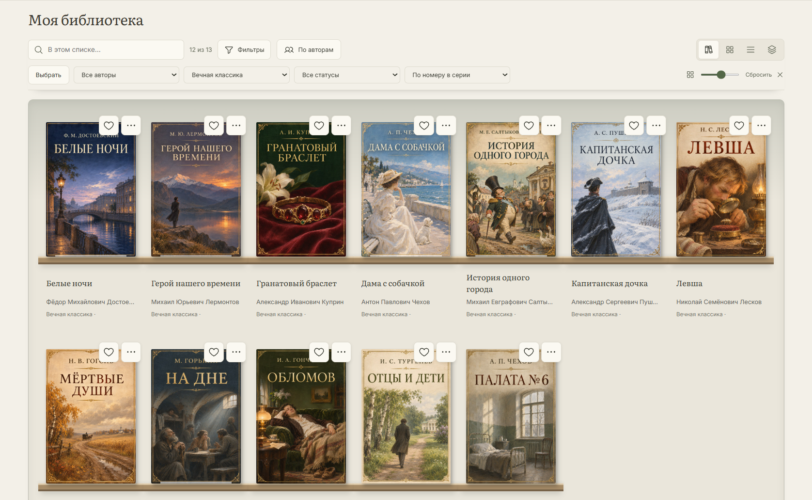
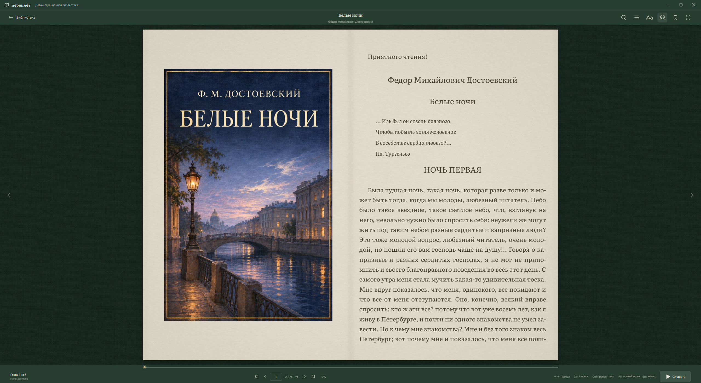
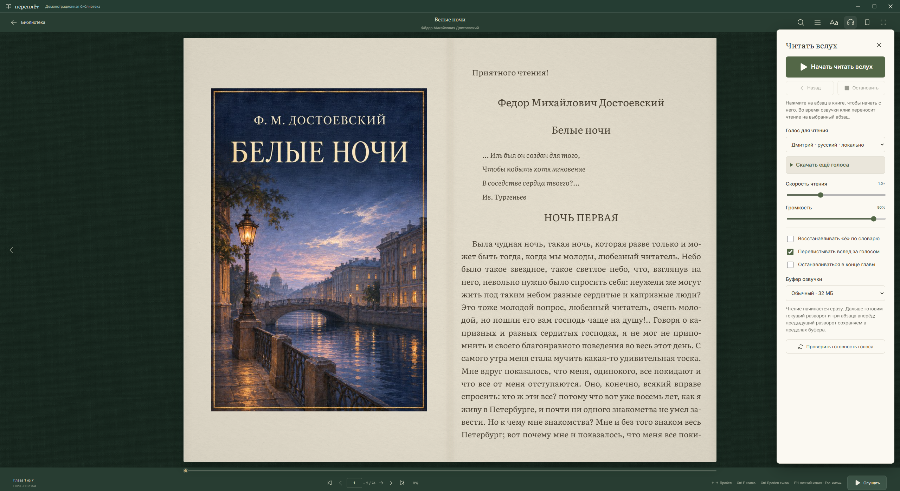
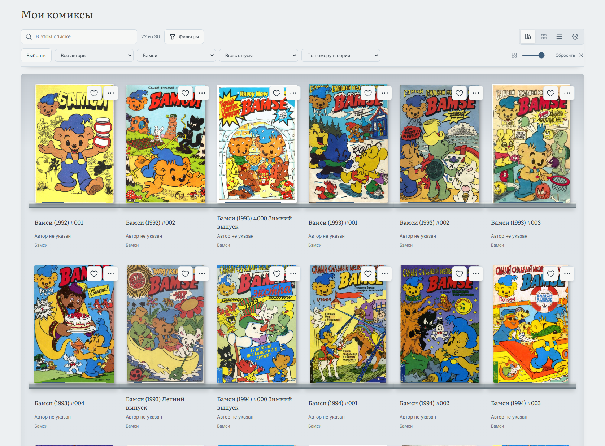
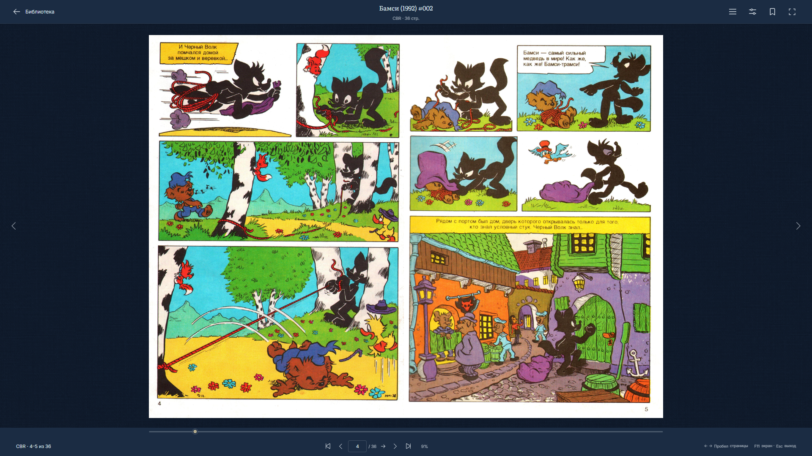

# Переплёт. Руководство читателя

## Добро пожаловать

Переплёт объединяет личную библиотеку, чтение книг и комиксов, сетевые каталоги и локальную озвучку. Это руководство поможет освоить основные действия. Откройте оглавление в верхней панели, чтобы перейти прямо к нужной теме.
В новой библиотеке есть эта инструкция и двенадцать произведений в серии «Вечная классика». Они доступны при любом оформлении. Вы можете читать их сразу или добавить собственные файлы.

После первого закрытия руководство исчезает с полки, но остаётся доступно через пункт «Помощь» в левом меню. Позиция чтения сохраняется. Чтобы убрать вводную подборку без чтения, нажмите «Скрыть с полки» рядом с руководством.

## Первые шаги

Распакуйте Windows-дистрибутив целиком в папку, доступную для записи, и запустите Pereplet.exe. Устанавливать Python, Node.js и WebView2 отдельно не требуется. Сервер работает только на вашем компьютере и завершается вместе с окном приложения.
Нажмите на обложку, чтобы открыть книгу. Кнопка «Библиотека» возвращает к коллекции. Место чтения сохраняется автоматически. Уже начатые издания доступны в разделе «Сейчас читаю» и в блоке «Продолжить чтение».
Для первого знакомства попробуйте «Белые ночи»: откройте книгу, перелистните страницу, измените шрифт и вернитесь в библиотеку. При повторном открытии приложение восстановит место чтения.

## Добавление книг и поддерживаемые форматы

Кнопка «Добавить книги» позволяет выбрать файлы; рядом находится добавление папки. Исходные документы остаются на месте: приложение хранит рабочие копии в собственной библиотеке.
Текстовые форматы: FB2, FB2.zip, EPUB и TXT. Их текст можно переразмечать под выбранный шрифт и размер страницы. PDF отображается с исходной вёрсткой. Комиксы поддерживаются в CBZ и CBR; PDF тоже можно поместить в раздел комиксов.
Если книга уже добавлена, приложение распознаёт совпадение файла. Ошибка импорта показывается отдельно: проверьте формат и целостность исходника. Расширение файла не всегда соответствует его содержимому.

## Порядок на полках

Вверху коллекции находятся поиск по текущему списку, фильтры, группировка, виды отображения и сортировка. «По сериям» объединяет выпуски в группы, а «По авторам» помогает рассматривать творчество одного писателя. При известных номерах книги сортируются внутри серии.
Указатели «Авторы» и «Серии» в левом меню позволяют открыть отдельную подборку. Фильтры внутри автора относятся к его книгам. Масштаб библиотеки меняется в «Настройках»: он увеличивает текст интерфейса и обложки вместе. По умолчанию выбран масштаб 115 процентов.
Сердечко добавляет книгу в «Хочу прочитать». Статус «Прочитано» можно назначить через меню издания. Сам по себе переход к последней странице не означает завершённое чтение.
Меню «…» содержит действия над одной книгой. Кнопка «Выбрать» включает массовые действия: назначение серии, смену статуса, перенос между книгами и комиксами, архивирование. Архив сохраняет книгу и позволяет вернуть её на полку.

## Оформление и режимы чтения

Откройте настройки в верхней панели книги. Выберите одну страницу, разворот или непрерывную прокрутку. Для текстовых книг доступны шрифт, размер, межстрочный интервал, поля, ширина и текстура бумаги. Пять тем меняют цвета библиотеки и окружения книги.
Автоматическая ширина разворота учитывает доступное место и ограничивает длину строки на больших экранах. Ручная настройка позволяет выбрать собственную ширину. Число страниц во всей книге пересчитывается в фоне после изменения оформления.
Переключатель общих настроек определяет, применяются ли изменения ко всем книгам без индивидуальных настроек или только к текущей. Размер интерфейса библиотеки не меняет размер букв на странице.
Полноэкранный режим включается кнопкой в верхней панели или F11. Escape позволяет выйти из него. Автоматическое скрытие инструментов включается отдельно и не меняет размер страницы. Двойной щелчок по заголовку окна разворачивает или восстанавливает окно.

## Поиск, закладки и иллюстрации

Нажмите Ctrl+F или значок лупы. В панели поиска выберите всю книгу или текущую главу, введите слово либо фразу и запустите поиск. Результаты содержат окружающий текст; совпадения выделяются в книге.
После перехода к результату можно вернуться к месту, где вы начали поиск, или остаться на найденной странице. Закладки помогают сохранить важные места независимо от текущей позиции.
Нажмите на иллюстрацию для отдельного просмотра. Колесо мыши меняет масштаб; «Вписать» подбирает размер под окно. Щелчок по изображению закрывает просмотр. При перетаскивании увеличенной иллюстрации обычное перемещение не должно восприниматься как закрывающий клик.

## Чтение вслух

Откройте панель со значком наушников и нажмите «Начать читать вслух». В готовой Windows-сборке уже есть голос «Дмитрий». Текст обрабатывается локально: для этой озвучки не требуется отправлять книгу на внешний сервер.
Нажмите на абзац книги, чтобы выбрать начало чтения. Во время озвучки такой клик переносит чтение к выбранному абзацу. Кнопки паузы, продолжения и остановки находятся вверху панели.
Скорость и громкость регулируются отдельно. «Восстанавливать ё по словарю» исправляет однозначные случаи только для произнесения; исходный текст книги не меняется. «Перелистывать вслед за голосом» помогает следить за чтением. Переход внутри длинного абзаца приблизителен и оценивается по длительности аудио.
Следующие главы читаются автоматически. Если нужна остановка в конце главы, включите соответствующую галочку. Буфер готовит видимый разворот и несколько абзацев вперёд постепенно; воспроизведение не ждёт заполнения всего буфера.
«Скачать ещё голоса» открывает список дополнительных моделей. Интернет нужен для загрузки; затем голос работает локально. Возможности и лицензии голосов различаются. Озвучка предназначена для текстовых книг: распознавание надписей на сканах PDF и картинках комиксов не выполняется.

## Комиксы: коллекция и серии

Откройте раздел «Комиксы». Форматы CBZ и CBR содержат последовательность изображений в ZIP- или RAR-архиве. Декодер RAR включён в Windows-сборку.
PDF может быть книгой или комиксом. Измените тип коллекции через меню «…» либо выделите несколько изданий и используйте массовый перенос. Это не преобразует файл и не меняет его страницы.
Если метаданных серии нет, выделите нужные выпуски и нажмите «Назначить серию». Можно выбрать существующее название или создать новое. Серии комиксов доступны в отдельном указателе. На иллюстрациях ниже показаны оригинальные демонстрационные истории Переплёта.

## Комиксы: страница и разворот

Откройте «Настройки страниц». Доступны страница, разворот и непрерывная прокрутка. Подгонка под окно использует свободную область; ширина страницы или разворота регулируется отдельно.
«Первая страница — отдельная обложка» определяет пары страниц. Если большой рисунок занимает весь разворот, выключите промежуток между страницами. «Выровнять высоту страниц» помогает при неодинаковых размерах сканов. Эти настройки можно сохранить для конкретного выпуска.
Листайте стрелками, колесом мыши или кнопками навигации. Соседние страницы готовятся заранее; пока следующий разворот загружается, текущий остаётся видимым. При возвращении к комиксу восстанавливается сохранённая позиция.
В PDF и комиксах шрифты и рисунки являются частью страницы. Изменение шрифта текстовой читалки на них не действует.

## Каталоги OPDS

Раздел «OPDS-каталоги» содержит преднастроенные адреса. Кнопка добавления позволяет подключить собственный каталог, например каталог вашей библиотеки. Доступность зависит от внешнего сервера: ошибка соединения не означает потерю локальных книг.
Откройте каталог и выберите раздел. Если сервер поддерживает поиск, используйте верхнюю строку. Некоторые каталоги предлагают отдельный поиск по книгам и авторам. История запросов появляется при фокусе в поле ввода.
Поле «В этом списке» фильтрует уже доступные записи текущего раздела. Дополнительные фильтры работают по переданным метаданным: языку, количеству авторов и другим признакам. Пустые группы после фильтрации не показываются; отсутствие метаданных ограничивает точность отбора.
Нажмите на книгу, чтобы увидеть карточку, описание и доступные переходы к автору или серии. «В библиотеку» загружает поддерживаемый файл. Наличие книги в каталоге не означает, что её формат доступен для чтения в приложении.
Списки подгружаются при прокрутке. История навигации помогает вернуться в предыдущие разделы; значок закладки сохраняет текущий раздел. Интернет нужен для просмотра и скачивания, а уже добавленная книга доступна офлайн.

## Обновление, перенос и резервная копия

Все пользовательские данные находятся в папке data рядом с Pereplet.exe: книги, база, настройки, позиции, загруженные голоса и служебные файлы. Перед копированием закройте приложение.
Чтобы сделать резервную копию, сохраните data целиком в другом месте. Для переноса на другой компьютер распакуйте программу и перенесите эту папку.
Чтобы обновить приложение, закройте его, сохраните резервную копию data и распакуйте новый дистрибутив поверх старого с заменой файлов программы. Не удаляйте data. Чистый архив выпуска не должен содержать пользовательскую папку data.
Стартовая подборка устанавливается только при создании новой библиотеки. Обновление не заменяет вашу коллекцию и не возвращает удалённые стартовые книги.

## Если что-то не работает

Не удаётся открыть каталог: проверьте интернет и повторите позже. Сторонние серверы могут временно отвечать ошибкой или менять адреса. Локальное чтение при этом остаётся доступным.
Не слышно голос: проверьте громкость в приложении и Windows, выбранный голос и готовность модели. В панели есть проверка готовности и загрузка дополнительных голосов. Распаковывайте дистрибутив целиком.
Не получается импортировать книгу: убедитесь, что файл не повреждён и его содержимое соответствует поддерживаемому формату. Для защищённых или нестандартных документов может потребоваться другой источник.
Интерфейс мелкий: откройте настройки библиотеки и увеличьте масштаб. Для букв внутри книги используйте отдельный размер текста в настройках чтения.
Для обращения за помощью полезно указать версию приложения, формат книги, последовательность действий и текст ошибки. Не отправляйте всю личную базу, если это не требуется для воспроизведения проблемы.
